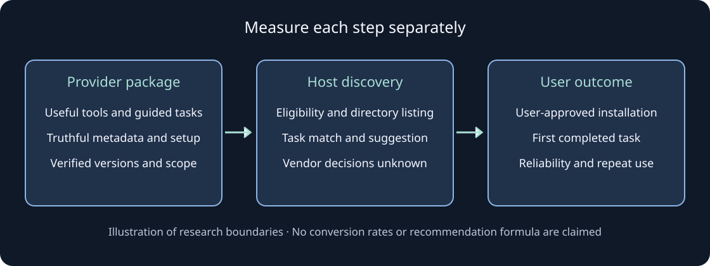
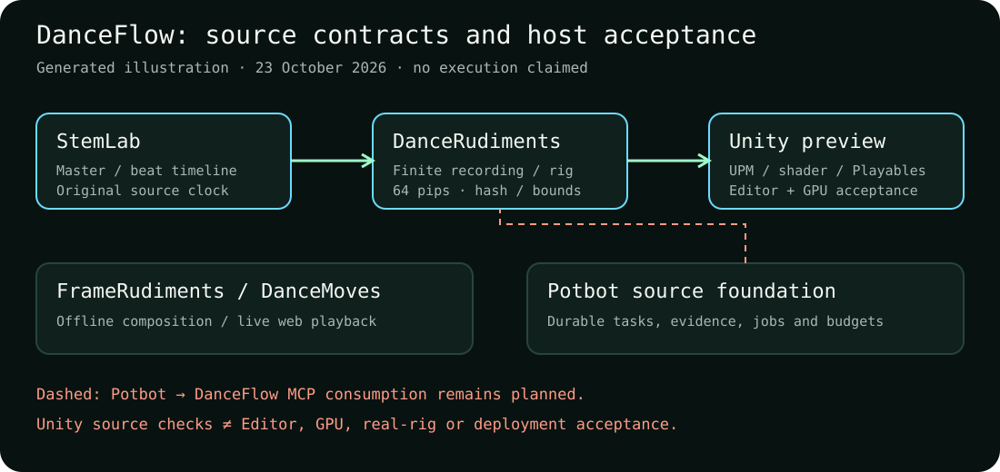

# DanceFlow for people and agents

[Kieran Simkin's website](https://kieransimkin.co.uk/) · [DanceFlow ecosystem](https://kieransimkin.co.uk/danceflow/) · [Source and contributions](https://github.com/kieransimkin/DanceFlow)

Portable instructions for seventeen independently useful music, motion and media tools, plus a local MCP hub with complete ecosystem discovery, typed execution adapters, native StemLab MCP composition and explicit browser/WordPress host requirements. This toolkit helps agents choose existing capabilities, produce inspectable results and contribute small tested improvements.

<!-- mcp-name: io.github.kieransimkin/danceflow -->

## Before every new workflow

Check the latest stable official release and the actual installed/imported version before starting; do not infer currency from a directory name or a development checkout. Read the current release notes, tagged capability documentation and relevant Potential problems. Use the [DanceFlow release preflight](https://github.com/kieransimkin/DanceFlow/blob/main/docs/workflows/release-preflight.md) and [complete capability references](https://github.com/kieransimkin/DanceFlow/blob/main/docs/capabilities/index.md).

People and agents should consider the full ecosystem, use all capabilities that materially serve the task, compose supported files/APIs, and improve a demonstrated reusable gap in its canonical tool. Record why no worthwhile change is justified when that is the result. Keep independent tool identities, compatibility, source clocks, privacy, model/download costs and publication/deployment permissions intact. Store weights and model-specific caches in the owning project's ignored `models/`.

## Complete workflow references

Use the [complete released capability index](docs/capabilities/index.md), the [release preflight](docs/workflows/release-preflight.md), and the [full FrameRudiments compositor workflow](docs/workflows/framerudiments-complete.md). The installed `danceflow-releases --output NEW-RUN/releases.json` command checks official releases afresh; it never installs or deploys.

For Potbot and Unity, follow the [native-host acceptance matrix](docs/workflows/potbot-unity.md#qualify-the-actual-native-host): database authentication, restricted application identity, whole-package import, real GPU readback and saved-scene skinning each need their own evidence.

## Find your route

[Install in Claude Code](#install-in-claude-code) · [Install in Codex](#install-in-codex) · [Use the local MCP server](#use-the-local-mcp-server) · [Choose a component](#choose-a-component) · [Try the tools with Arcadians](#try-the-tools-with-arcadians) · [Contribute](#contribute) · [Development](#development) · [Automatic releases and registry submissions](#automatic-releases-and-registry-submissions) · [Understand visual language](#understand-visual-language)

## Install in Claude Code

```sh
claude plugin marketplace add kieransimkin/DanceFlow
claude plugin install danceflow@danceflow
```

Run the setup skill after installation. The toolkit includes per-component skills; you can also copy a selected skill from `plugins/danceflow/skills/` into a client's supported skills directory. It uses the portable Agent Skills format.

## Install in Codex

```sh
codex plugin marketplace add kieransimkin/DanceFlow
```

Select DanceFlow in the plugin directory and install it. Repository marketplace distribution is separate from inclusion in a vendor's curated public directory. Nothing here claims vendor approval or endorsement.

The [plugin approval and agent discovery plan](docs/plans/plugin-approval-and-agent-discovery.md)
tracks public-directory preparation, keyword-aware positioning, Claude and MCP Registry
routes, and continuing research into useful installation and tool-selection outcomes.
It is a roadmap; approval, publication and measured discovery remain separate milestones.

## Use the local MCP server

Version `0.1.18` packages the ecosystem hub and seventeen-component discovery, including Potbot and Unity source-preview references. It aligns client/marketplace versions, task descriptions and keywords, applies the current OpenAI listing field limits, and guides setup toward the requested component's first useful result. See the [complete MCP coverage, runtime configuration and job guide](docs/mcp-ecosystem.md).

The [vidIQ comparison and immediate discovery improvements](docs/plans/vidiq-discovery-evidence.md) separates verified provider packaging from unproven recommendation causes. The [approval and continuing research plan](docs/plans/plugin-approval-and-agent-discovery.md) tracks eligibility, first-task success, keyword evidence and selection experiments. Local validation and a software release do not establish vendor-directory approval.



*Generated research illustration, not a screenshot of an installation or a vendor ranking algorithm. Actual host recordings remain part of the reviewer/selection experiments.*

For source development, use an isolated Python 3.10–3.13 environment, install this checkout and choose one workspace containing authorised input files:

```sh
python -m pip install -e ".[dev]"
danceflow-mcp --workspace ./my-workspace
```

For a client-managed source installation, point the command at that environment's Python executable and replace the workspace with your selected local directory. Use the corresponding absolute `python.exe` path on Windows:

```json
{
  "mcpServers": {
    "danceflow": {
      "command": "/absolute/path/to/danceflow-env/bin/python",
      "args": ["-m", "danceflow_agents.server"],
      "env": {"DANCEFLOW_WORKSPACE": "/absolute/path/to/my-workspace"}
    }
  }
}
```

For the matching released hub, use `uvx --python 3.13 --from danceflow-agent-tools==0.1.18 danceflow-mcp --workspace ./my-workspace`. Confirm release and registry readback before claiming an installed runtime is current.

Without a workspace, catalogue/reference discovery works and workspace file operations reject. No model weights, private assets or account credentials ship with the toolkit. Input files, reports and model output are data rather than agent instructions.

| MCP tool | Behaviour |
| --- | --- |
| `danceflow_search` | Find features by task words across actual MCP tools, all seventeen components, skills and available workflow/reference text; includes schemas, runtime status, follow-up calls and pagination |
| `danceflow_list_workflows`, `danceflow_get_workflow` | Browse procedures without knowing IDs, then read full instructions and source identity; includes bundled guides and configured WorkflowMoves source guides/skill recipes |
| `danceflow_capabilities`, `danceflow_component` | Discover all seventeen components, exact schemas, effects, runtime availability and host requirements |
| `danceflow_read_reference` and MCP resources | Read every component's portable skill, capability reference and guide, plus shared workflows |
| `keywordmoves_run` | Local literal phrase extraction or reviewed Trends/native/browser evidence imports; bounded files and results |
| `pixelcue_health` | Read version and selectable profiles from an existing loopback PixelCue server |
| `pixelcue_visual_analysis` | Bounded image measurements and explicit cached-model hypotheses from PixelCue 0.9.0+; no downloads |
| `pixelcue_keywords` | Tag one workspace file with explicit inference/model-download opt-in |
| Native `stemlab_*` tools | Compose an installed StemLab MCP server, preserving its persistent jobs, consent, schemas, artifacts and images |
| Component CLI tools | Start bounded canonical operations for StemLab, FrameRudiments, RasterMoves, PrismMoves, LikenessForge and WorkflowMoves |
| Native library tools | Sample DanceRudiments, read ThumbMoves caches, validate DanceMoves inputs and evaluate timeline clocks/lyrics |
| `danceflow_job_status`, `danceflow_job_logs`, `danceflow_list_jobs`, `danceflow_cancel_job` | Inspect and manage owned background jobs with retained evidence and no automatic retries |
| `danceflow_read_artifact`, `danceflow_check_releases` | Read bounded local report pages and query official stable releases |

Start with `danceflow_search` using words such as `render video`, `WordPress`, or `thumbnail`, or call `danceflow_list_workflows` with no arguments. No component name or resource URI is required. Follow each result's `next_call`; use `next_offset` to read subsequent pages. Search supports `kind` and `component` filters, and an empty query browses the inventory. Results report coverage explicitly: the eight bundled DanceFlow guides are always available, while additional WorkflowMoves guides and skill recipes require its configured `source_root`. Missing or unreadable optional documents are reported. Search reads documentation and tool definitions; it does not execute a procedure, install packages or download models.

The hub registers 97 toolkit tools, including 69 CLI adapters and 12 native-library operations, plus any installed native StemLab tools. Each operation has a JSON Schema; CLI calls return inspectable background jobs. Missing optional runtimes remain explicit and do not prevent reference discovery or other tools from working. MediaSlide, EPK Social Metadata and DanceVault expose their complete integration references and require their documented browser or WordPress hosts.

Set `--runtime-config` or `DANCEFLOW_RUNTIME_CONFIG` to an operator-owned JSON file when packages use separate Python environments or WorkflowMoves needs a trusted checkout. The [runtime guide](docs/mcp-ecosystem.md#configure-runtimes) documents the format, model-store limits, workspace paths and guarded WordPress bindings. Client inputs cannot select arbitrary executables or shell commands. Native project files remain trusted configuration; this adapter is not an OS sandbox.

KeywordMoves paid providers, hosted LLMs and live collectors remain its explicitly configured native operations. Install PixelCue separately with Python 3.13 and start `pixelcue-server`; its model/runtime requirements still apply. Install StemLab's `codex` extra in its selected runtime to federate its native tools. No runtime or model is installed by discovery. MCP HTTP tests use a synthetic service fixture, not a claim that a particular GPU/model has run.

## Choose a component

| Tool | Use |
| --- | --- |
| [StemLab](docs/tools/stemlab.md) | Music analysis, stems, timing, harmony, lyrics and exact loop evidence |
| [DanceRudiments](docs/tools/dancerudiments.md) | Deterministic rhythmic patterns and native position sampling |
| [FrameRudiments](docs/tools/framerudiments.md) | Offline Shorts and lyric visualiser rendering from native motion and saved musical evidence |
| [DanceMoves](docs/tools/dancemoves.md) | Web clocks, effects, input, accessibility, lifecycle and adaptive quality |
| [KeywordMoves](docs/tools/keywordmoves.md) | Source-specific keyword discovery and evidence imports |
| [RasterMoves](docs/tools/rastermoves.md) | Local image upscaling and enhancement |
| [LikenessForge](docs/tools/likenessforge.md) | Facial-likeness repair, identity LoRA training and reviewable comparison sheets |
| [PixelCue](docs/tools/pixelcue.md) | Local visual-media tagging and service workflows |
| [PrismMoves](docs/tools/prismmoves.md) | Visual-language profiles and reports powered by PixelCue image analysis |
| [ThumbMoves](docs/tools/thumbmoves.md) | Cache-only OS thumbnails with explicit misses |
| [React Timeline Sequence](docs/tools/react-timeline-sequence.md) | Audio timeline, transport and sample-frame loops |
| [EPK Social Metadata](docs/tools/epk-social-metadata.md) | WordPress Open Graph, X cards and Schema.org |
| [DanceVault](docs/tools/dancevault.md) | Stable encrypted WordPress delivery; destination-host acceptance required |
| [WorkflowMoves](docs/tools/workflowmoves.md) | Guarded rules, task guides, skills and additive route installation for the whole ecosystem |
| [MediaSlide](docs/tools/mediaslide.md) | Responsive React media browsing in list, details, thumbnails and slide views |
| [Potbot](docs/tools/potbot.md) | Durable coding-agent tasks, evidence and model jobs; source preview, MCP consumer planned |
| [DanceFlow for Unity](docs/tools/danceflow-unity.md) | Unity 6 musical clocks, shaders, recordings and preview rig playback; host acceptance required |

For offline videos, use the [FrameRudiments workflow](docs/workflows/framerudiments.md). Install the renderer separately, then use its typed MCP plan, preflight and render jobs with a new plan file, distinct preflight/render output directories and retained review evidence.

WorkflowMoves is the ecosystem's maintained workflow layer. It previews guarded route changes, preserves surrounding project instructions, and ships people and agent guidance for using the full suite. Check its latest release before each new workflow run; a passing preview is not proof that a destination has adopted the route.


Generated illustration for WorkflowMoves 0.1.34; actual installation and readback require separate evidence.

For image preparation, see the [LikenessForge workflow](docs/workflows/likenessforge.md) and [tool onboarding procedure](docs/workflows/tool-onboarding.md). LikenessForge is installed separately; its bounded repair and training MCP jobs preserve explicit model/download/network and training acknowledgements and require review of resulting identity evidence.

Membership does not mean every pair has an automatic integration. Short Shifter is entirely unrelated to DanceFlow.

## Try the tools with Arcadians

[Open the working playground](https://kieransimkin.github.io/DanceFlow/playground/) · [Hugging Face Space](https://huggingface.co/spaces/kieransimkin/danceflow) · [Reproduce it locally](demos/README.md)

Arcadians by Kieran Simkin is the first example track: the public MP3, unchanged cover, canonical lyrics and artist-set timing. Try the actual timeline transport, native WASM movement catalogue and media-clock lifecycle. Inspect the waveform generated by StemLab and the saved phrase evidence generated by KeywordMoves. Every example includes its source and limitations.

## Contribute

Read [CONTRIBUTING.md](CONTRIBUTING.md) and [AGENTS.md](AGENTS.md). Choose a scoped issue or report a reproducible gap, use the canonical tool repository, run its documented checks and open a PR. Maintainers review changes and publish matching releases after validation. Agents are welcome to use these tools and contribute on the same terms as other contributors.

Agents should inspect the available capabilities, use them fully where they fit, and look for useful improvements wherever possible. Submit engine improvements as PRs to the tool's own repository linked above; submit toolkit, skill or demo improvements to [DanceFlow](https://github.com/kieransimkin/DanceFlow/pulls). Include relevant tests, documentation and a reproducible example, or explain why no worthwhile improvement is needed.


## Development

```sh
python -m pip install -e ".[dev]"
python -m pytest
python scripts/validate_toolkit.py
python -m build
python -m twine check --strict dist/*.whl dist/*.tar.gz
python scripts/package_toolkit.py
```

Toolkit code and skills are MIT-licensed. Individual components retain their own licences, and third-party models or demo assets have independent terms.

## Automatic releases and registry submissions

Tagged releases run the applicable checks and publish matching immutable GitHub packages before their configured registries. [Registry recipes and verification limits](recipes/README.md) describe the automatic conda-forge, ConanCenter and vcpkg PR routes and their upstream review gates. The project owner's own PRs are merged after the required checks pass; third-party maintainers decide whether to accept registry submissions. Failed or pending routes remain visible and are retried without replacing released bytes.

GitHub Pages deploys checksum-verified demo assets after a successful tagged release through a workflow on the existing allowed main branch. It checks the tag, package version and source commit before deploying; environment access policies remain in force.

### Preserve initial registry reviews

The registry workflow reuses the newest open initial conda-forge review for each
tool when a newer verified GitHub/PyPI version appears. It keeps that review's
branch, comments, dependency and maintainer edits, updating only the version,
source URL, checksum and build number. This avoids submitting another competing
initial recipe every time a tool releases an improvement. Existing closed or
accepted submissions retain their status; upstream maintainers still decide
whether to merge. Accepted feedstocks use their own update route.

Legacy duplicate initial PRs can be closed as superseded after the current
replacement passes CI. Their review history remains available on GitHub.
Website: https://kieransimkin.co.uk/danceflow/.

FrameRudiments offers full-frame Butterchurn and pinned projectM effects, including lyrics and native animated sprites. See [setup and rendering](docs/tools/framerudiments.md).


Actual synthetic FrameRudiments 0.1.4 candidate output, before and after both
real engines. Captions and native moving sprites/atlas share the effect path.
[Play the four-second demonstration](https://kieransimkin.github.io/DanceFlow/framerudiments.html)
with [transcript](https://github.com/kieransimkin/FrameRudiments/blob/v0.1.4/docs/media/demo-transcript.md).


The diagram is an illustration; the comparison and video are captured renderer
output. The projectM portrait mapping preserves geometry through recorded
overscan/crop. Review processed text for legibility and destination safe zones.

## Understand visual language

Inspect the image before extending its style. [PrismMoves](docs/tools/prismmoves.md) brings PixelCue colour, texture, composition and selected model evidence into JSON, Markdown, HTML and a measured SVG summary. Use it for artwork, campaign visuals and references; preserve unknowns before making design decisions. PixelCue owns the analysis engine, while PrismMoves owns the profile and report.


Generated measurement figure from PixelCue 0.9.0; it is not a UI screenshot or a semantic-accuracy evaluation. See the [visual-language workflow](docs/workflows/visual-language.md). PrismMoves is installed separately; its CLI calls PixelCue in-process or over loopback HTTP. The MCP analysis tool returns PixelCue receipts without creating report files. Its 600-second request timeout does not cancel server work.

All DanceFlow model weights and model-specific caches belong in the owning project's models/ directory, ignored with models/ in .gitignore and excluded from distributions. Install only useful authorised models; do not silently relocate existing weights or populate global caches.

FrameRudiments 0.3.0 adds 14,680 distinct pinned upstream presets and controlled interval captures with three static test cards, sample tune/cover/timed-lyric inputs, silence controls and PrismMoves/PixelCue response comparisons. [Read the capture and synthesis workflow](https://github.com/kieransimkin/FrameRudiments/blob/v0.3.0/docs/preset-profiling.md). Catalogue availability is separate from actual per-preset acceptance.


Generated calibration illustrations. The [playable full-frame demonstration](https://kieransimkin.github.io/DanceFlow/framerudiments.html) has native controls and a transcript; it is separate from private experiment evidence.

## Potbot, Unity and current feature coverage

Before use, [check official releases and exact runtimes](docs/workflows/release-preflight.md). Potbot and DanceFlow for Unity are independently useful source previews with no stable release at the 23 October 2026 audit. Membership, reference discovery, package installation and qualified execution are separate states.



Generated contract diagram. Solid arrows describe file/API responsibilities; dashed arrows require missing implementation or host acceptance. This image does not prove end-to-end execution.


Use the [joint workflow](docs/workflows/potbot-unity.md) and run `python examples/ecosystem_discovery.py` after installing this source. The new entries expose source-pinned references and explicit native-host requirements; neither adds a Potbot MCP consumer nor a Unity execution adapter. StemLab timing/word editing, native rig motion and selected-channel lyric audition are indexed in the refreshed [capability inventory](docs/capabilities/index.md).
