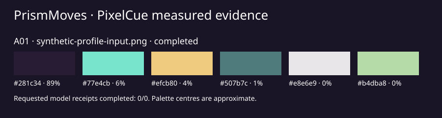

# PrismMoves visual-language analysis

Generated: 2026-10-18T22:58:14.331345+00:00

PixelCue owns the image measurements and model analysis. PrismMoves organises the evidence.

Generated graphic from the actual PixelCue receipts; model interpretations still require visual review.

## Evidence ledger

| ID | Image | Role (supplied) | Lineage (supplied) | SHA-256 | State |
|---|---|---|---|---|---|
| A01 | synthetic-profile-input.png | unknown | unknown | 44bd6132fef49120879359d8c2a0f6242c902d8f2d8e78e73646a462b42ec058 | completed |

## A01: synthetic-profile-input.png

### Observed measurements

- Oriented source: 960 × 960 px. Analysis raster: [768, 768].
- Palette (approximate sampled centres): #281c34 (89%), #77e4cb (6%), #efcb80 (4%), #507b7c (1%), #e8e6e9 (0%), #b4dba8 (0%).
- Mean HSV saturation: 0.468; grayscale entropy: 4.306 bits.
- Linear luminance percentiles (0/5/50/95/100): 0.001, 0.012, 0.016, 0.626, 1.000.
- Edge density at the stated threshold: 0.060.
- Mirror errors, horizontal/vertical: 0.035 / 0.116 (0 means exact mirror equality).
- Colour handling: assumed sRGB; no embedded ICC profile. Alpha composited over #ffffff.

### Model interpretations

No semantic or OCR models requested. Subjects, medium, materials and emotional tone remain unknown.

### Visual-language coverage

| Axis | Evidence and limits |
|---|---|
| Palette and contrast | Measured palette, luminance and saturation. Roles and actual text adjacency need visual review. |
| Typography and marks | OCR hypotheses if requested and available. Font, mark ownership and malformed lettering require review. |
| Subjects, motifs and setting | Caption, CLIP or PixelCue tag hypotheses if requested; no verified object inventory. |
| Composition, hierarchy and crop | Measured edge/grid/mirror/frequency features and a signal novelty proxy. Focal intent and safe zones require review. |
| Medium, texture, material, light and grade | Measured LBP, co-occurrence and FFT features. Material, medium and lighting are model hypotheses. |
| Motion and interaction | Unknown from a still image. |
| Tone, narrative and representation | Optional prompt-relative tone hypotheses. Intent, audience and personal identity remain unknown. |
| Accessibility and provenance | Dimensions, alpha and colour handling measured. Rights, approval and accessibility conformance remain unknown. |

### Limitations

- Measurements describe a composited, bounded analysis raster, not untouched source pixels.
- One image does not establish recurring brand rules, lineage, intent, rights or audience response.
- Motion, responsive behaviour, font identity, consent and actual legibility require separate evidence.

## Unknowns and conflicts

- Artist intent, approval, provenance, reuse rights and consent are unknown unless supplied as reviewed context.
- A single image cannot establish core invariants, controlled variation, negative rules or outliers.
- Model outputs are interpretations; unrequested and unavailable models do not establish absence.
- Palette contrast and saliency proxies do not establish actual text legibility, gaze or accessibility compliance.
- Static images provide no evidence of animation, phone input, responsive layout or temporal rhythm.

## Proposed next evidence

- Review semantic and OCR hypotheses against the actual image.
- Compare independently authored approved assets, with dates, roles and lineage, before declaring identity rules.
