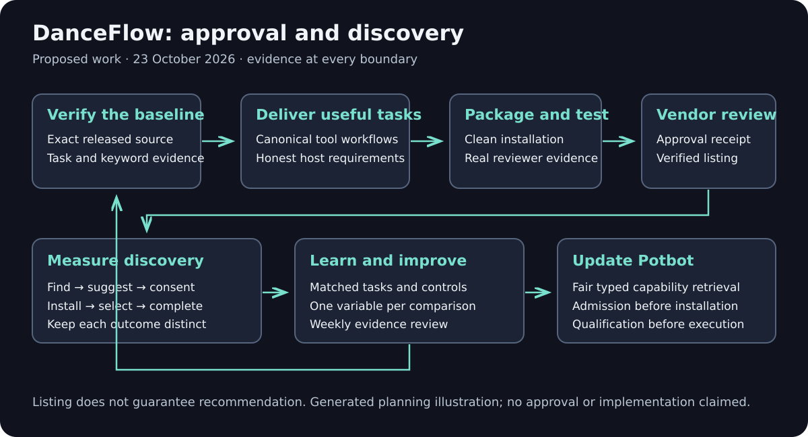
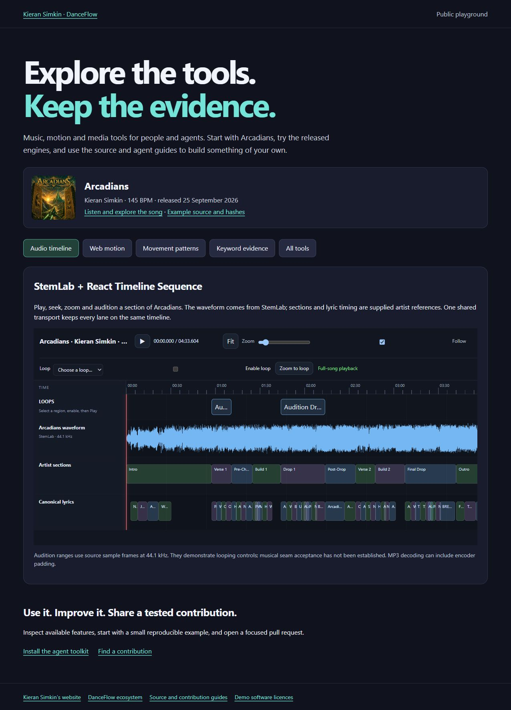

# DanceFlow plugin approval and agent discovery plan

Prepared 23 October 2026, Europe/London. Owner: Kieran Simkin. Status: active goal; planning baseline, not a submitted or approved plugin. Scope: the whole DanceFlow ecosystem, including discovery by OpenAI, Claude and other compatible agent systems. Short Shifter remains independent.

Blogworthiness: FAIL for this planning activity: the deliverable is a roadmap and research protocol; no new integration, approval, installation or selection result has been demonstrated. Reassess actual experiments and milestones separately.

Follow-up, 23 October: the [vidIQ primary-source comparison](vidiq-discovery-evidence.md) adds immediate listing/version fixes, an evidence-labelled comparison with Metricool and a bounded research backlog. The `0.1.18` candidate aligns manifests, marketplace identities, task keywords/prompts and setup; its local/CI/release evidence is separate from vendor approval and measured selection. That technical follow-up is assessed separately from the original planning activity.

## Outcomes and proof

The finite goal is a useful, tested DanceFlow umbrella plugin approved for OpenAI's public directory and independently verified after publication. The continuing goal is to learn how agent systems find, recommend, install and select integrations, and improve DanceFlow and Potbot from reproducible evidence. Directory approval does not guarantee recommendation placement.

| Outcome | Completion evidence |
| --- | --- |
| Approved | Portal decision for the exact submitted identity and version; retain any conditions. |
| Publicly listed | Fresh directory lookup and working listing URL, separate from the approval receipt. |
| Installable | Clean installation on each claimed host, exact package identity and successful onboarding. |
| Discoverable by task | An unfamiliar, permitted session finds DanceFlow from an ordinary task without being given its name, URL or installation command. |
| Suggested for installation | The host proposes the relevant integration to an uninstalled user; record the prompt, available directory and outcome. User consent remains required. |
| Selected after installation | An installed, enabled host chooses a suitable capability without an explicit tool mention and completes the intended task. |
| Ongoing learning | Dated evidence, updated hypotheses, measured changes and an actionable next experiment; never infer platform algorithms from one response. |

*Generated explanatory diagram, 23 October 2026. It describes proposed work, not an implemented remote service, vendor approval or measured recommendation.*

## Verified starting point and open questions

- GitHub main inspected at [`a424100b4293d83bf9aa4044d64f0ea753770a59`](https://github.com/kieransimkin/DanceFlow/commit/a424100b4293d83bf9aa4044d64f0ea753770a59). The latest GitHub release observed was [v0.1.16](https://github.com/kieransimkin/DanceFlow/releases/tag/v0.1.16). Main contains substantial subsequent MCP changes; its unchanged version label is not proof the released wheel contains them.
- There is already a portable manifest, Claude and Codex overlays, two repository marketplaces, a PyPI package, MCP Registry metadata, release automation and fifteen component entries. Preserve these rather than starting another implementation.
- [`docs/mcp-ecosystem.md`](../mcp-ecosystem.md) describes source-level task search, workflow retrieval, native federation, typed jobs and host requirements. Validate the actual release before advertising those interfaces. Browser and WordPress dependencies remain explicit.
- The packaged MCP launch configuration is local `uvx`/stdio. Public remote hosting, vendor-directory approval, publisher verification, account eligibility and live reviewer access have not been established by this work. OpenAI plugin search returned no DanceFlow match; that does not establish absence of drafts, restricted listings or earlier submissions.
- Existing keyword strategy prioritises music analysis, lyric/video rendering and live web animation. A local KeywordMoves 0.5.8 literal extraction was retained privately. Its occurrence counts describe the reference document, not market demand or directory ranking.

*Existing actual local-build screenshot, 8 October 2026; provenance and hash are in [verification.json](../screenshots/verification.json). This illustrates an existing demonstration asset, not the proposed plugin installation flow. Capture fresh host demonstrations in step 11. A new recording adds no evidence to a static roadmap, so none is claimed here.*

## Route decision before implementation

Keep the DanceFlow identity and complete component routing in one umbrella package. Use host-specific packaging around shared skills and canonical engines. A component's appearance in the catalogue does not mean every function works on every host.

| Route | Use and decision gate |
| --- | --- |
| OpenAI remote MCP plus skills | Preferred investigation for broad ChatGPT access. Needs a genuinely useful hosted workflow, a production HTTPS endpoint and controlled workers; a directory of documentation alone may not meet utility expectations. No endpoint is deployed by this plan. |
| OpenAI local MCP plus skills | Preserves local files and engines. Current documentation restricts local MCP submissions to approved partners; establish actual eligibility before spending implementation effort on this route. |
| OpenAI skills-only desktop package | A deliberate alternative for valuable local workflows if eligible. Do not remove MCP merely to pass validation: the documented flow currently cannot add MCP to an existing skills-only listing later. Record the product and identity trade-off first. |
| Claude plugin bundle | Reuse the GitHub plugin and local MCP for supported desktop/Code execution, with truthful per-surface support. Submit through Claude's directory portal; this is separate from the restricted official Claude Code marketplace. |
| Claude remote connector | If a shared remote service is built, submit it separately as a connector as well as the plugin. Do not treat a plugin listing as connector approval. |
| MCP Registry and other clients | Maintain discoverable, verified package/transport metadata. Registry publication is independent of vendor approval and does not mean a client automatically imports or installs it. |

Source requirements: [OpenAI submission](https://developers.openai.com/plugins/deploy/submission), [desktop eligibility](https://developers.openai.com/plugins/deploy/desktop-only), [Claude plugin submission](https://claude.com/docs/plugins/submit), [Claude distribution routes](https://code.claude.com/docs/en/plugins/publish), [Claude connector submission](https://claude.com/docs/connectors/building/submission).

## Ordered implementation and approval work

Each checkbox is an outstanding action, with an explicit deliverable and exit test. The preparation performed above does not close these gates.

1. [ ] **Reconcile source and published identities.** Inventory all seventeen current components, runtime prerequisites, licenses, platform support and exact released versions. The initial observation above preceded v0.1.17, subsequently released from `99519e89627750beb1bd6c9bf51bb35ae090bca5`; reconcile the current tag/package and any successor rather than treating the historical v0.1.16 gap as current. Potbot and Unity remain source previews. Deliver `release-baseline.json`; exit when every advertised operation maps to tested release bytes or is labelled unavailable. Do not install every optional dependency merely to inventory it.
2. [ ] **Inventory previous submissions and permissions.** Read existing OpenAI and Claude portal records before creating drafts. Identify publisher, owning organization/project, identity verification, submission roles, GitHub connection and any local-MCP allowlisting. Retain private receipts and exact missing prerequisites. Never infer eligibility from subscription level or repository ownership alone. Dependency: none; begin alongside step 1.
3. [ ] **Build the keyword and user-intent evidence map.** Start from the table below and existing strategy. Use KeywordMoves to retain literal source spans and import authorised native search evidence. Record source, date, geography, period, unit and availability for each observation. Select three lead user jobs using relevance, actual capability and reproducibility; demand is a separate field. Exit with reviewed `intent-map` and held-out test prompts, without invented volume.
4. [ ] **Choose and record the initial product route.** Compare remote service, partner-eligible local MCP and skills-only desktop against the same real user jobs. Document coverage, privacy, operating cost, host reach, setup friction and future MCP migration consequences. Prefer the smallest route that delivers the promised result for the whole umbrella. Exit with an architecture decision and named eligibility/infrastructure dependencies. Depends on 1–3.
5. [ ] **Define complete, bounded workflows.** Specify inputs, outputs, prerequisites and failure states for music analysis/timing, deterministic lyric-video rendering, and media-clock web animation. Route to StemLab, FrameRudiments, DanceRudiments and DanceMoves through supported interfaces; keep supporting tools discoverable. Choose synthetic/public-safe fixtures and licensed assets. Exit when each claim has a reproducible fixture and a clear distinction between local and hosted execution.
6. [ ] **Qualify remote infrastructure only if selected.** Design one HTTPS MCP endpoint with strict schemas and bounded tenant-owned jobs. Use canonical engines in isolated workers, not arbitrary shell or user-selected executable execution. Establish file-transfer consent, artifact ownership/expiry, cancellation, concurrency, limits, retention, abuse controls and actual cost ceilings. Account tools need appropriate authorization; public read-only data may need none. Prove isolation, deletion and failure recovery before accepting user uploads. Deployment, new spend, account changes and legal commitments retain their own authority.
7. [ ] **Make discovery metadata truthful and useful.** Describe each tool's task, inputs, output, limits and side effects in ordinary language. Include real titles, strict schemas and accurate effect annotations; annotations never grant authority. Derive task-search entries from actual callable definitions and versioned workflows so they cannot drift independently. Expose missing engines and host requirements accurately. Exit with schema/description review and keyword-to-capability coverage checks.
8. [ ] **Prepare portable and host-specific packages.** Validate root `plugin.json`, MCP transport declarations, skills, setup path and overlays against current host schemas. Remove hard-coded personal paths, private coordination, credentials and model weights. Keep declared installation prerequisites accurate. Build a submission ZIP rooted at the actual plugin, separate from the full toolkit/demo archive; retain a file manifest and SHA-256. Depends on route and tested capabilities.
9. [ ] **Prepare listing and policy materials.** Use the stable DanceFlow name, concise task-led description, selected prompts, original icon and accurate support/documentation links. For remote MCP review, provide the required product, support, privacy and terms URLs and developer identity. Policies must describe the implemented data flow; do not publish draft legal assertions as facts. Review current portal field limits; the observed short description is 39 characters and needs correction if the current limit remains 30. [Submission field checks](https://developers.openai.com/plugins/deploy/submission-errors).
10. [ ] **Run clean installation and reliability gates.** Test actual package installation, onboarding, permission denial, absent optional engines, offline operation where claimed, cancellation, bounded files/jobs, malformed results and injection-like content in data. Preserve sample clocks, exact master/fixture identity and model-local storage. Run repository tests and toolkit validation for implementation changes. Verify Linux/Windows and any additional platform actually claimed; unsupported hosts must say so.
11. [ ] **Assemble reviewer evidence.** Capture actual host install, setup, three useful workflows and a failure path with narration/captions. Fresh screenshots and a user-controlled video must match the candidate hash and disclose synthetic fixtures. For initial OpenAI MCP review prepare exactly five positive and three negative cases with expected tool calls and observable results; keep broader internal tests separate. Store reviewer access securely in the portal, never in the ZIP. Depends on 8–10. [Submission readiness checks](https://developers.openai.com/plugins/deploy/submission-errors).
12. [ ] **Submit the exact OpenAI candidate.** Re-read the current submission rules. Select the existing identity/draft where available, upload the reviewed ZIP, finish metadata/skill scans and, for remote MCP, verify domain, auth and current discovered tools. Resolve required findings before submission; retain status, candidate hash and submission ID privately. External submissions require the existing duplicate-send/claim and exact-action review. A successful upload is a draft, not approval.
13. [ ] **Submit the Claude package and applicable connector.** Validate the actual plugin folder, README/license and per-surface components; submit the correct repository, folder and tracked branch/tag. Keep plugin and remote-connector submissions distinct. Preserve review and publish settings, rather than enabling future automatic updates accidentally. Retain findings and decisions against exact commits. Depends on clean installation and current paid-plan/role eligibility.
14. [ ] **Resolve review findings and verify publication.** Turn each finding into a reproducible check, make the smallest canonical fix and revalidate the full exact candidate. Keep previous safe packages. Publish approved software through the established release/registry checks; vendor listing publication remains a separate action under applicable authority. Verify directory search, listing URL, clean install and actual workflow output independently for both vendors. Do not equate review submission, approval and publication.
15. [ ] **Reconcile the MCP Registry.** Read back `io.github.kieransimkin/danceflow`, verify namespace ownership, package version/digest, required environment variables, supported transport and website. Update existing metadata through the established release workflow after underlying packages are verified. Inspect failed registry jobs rather than assuming publication from a successful GitHub release. Document each downstream directory's actual ingestion relationship before expecting propagation. [Registry publishing](https://modelcontextprotocol.io/registry/quickstart), [package types](https://modelcontextprotocol.io/registry/package-types), [GitHub Actions](https://modelcontextprotocol.io/registry/github-actions).
16. [ ] **Test discovery on other clients.** Maintain a compatibility matrix for Claude Code, Claude chat/Cowork, Codex/ChatGPT, Potbot and candidates such as Cursor, VS Code and Gemini CLI. Verify each chosen client's current official installation/discovery contract before supporting it. Prioritise two functioning non-OpenAI routes, not a speculative claim of universal compatibility. Keep unknown, unavailable, unsupported and tested states separate.
17. [x] **Update Potbot's discovery strategy.** [PR 2](https://github.com/kieransimkin/potbot/pull/2) merged the [strategy](https://github.com/kieransimkin/potbot/blob/main/docs/implementation/plugin-discovery-strategy.md) and T04.1–T04.4 references as `24696ac6665878d9b10c0b5adb8b55abebbd34c3` after all required checks passed. All 48 stage statuses were retained. The vidIQ comparison reinforces provenance, host-specific surfaces, setup/cost/permission state and separate retrieval/admission/installation/qualification gates. Implementation and agent-selection acceptance remain outstanding; DanceFlow receives no owned-project ranking preference.
18. [ ] **Run and retain the selection benchmark.** Use the experiment protocol below before/after each material metadata, onboarding or reliability change. Separate uninstalled discovery, installation recommendation, completed installation and installed-tool selection. Compare completed tasks as well as mentions. Exit with reproducible observations and a bounded decision, not a ranking claim from a single chat.
19. [ ] **Maintain the research loop.** Review official changes weekly, review comparable complete measurement windows monthly, and rerun affected checks after schema/metadata/runtime changes. Update this plan, the research log and Potbot's strategy when evidence warrants it. Keep quiet when nothing actionable changes. Approval can close its milestone; the learning track continues until Kieran changes it.
20. [ ] **Keep evidence and public claims current.** Reconcile README, capability guides, maintained skills, support pages and directory metadata after verified changes. Assess blogworthiness on every run; qualifying experiments need duplicate review, fresh pictorial artwork, real demonstrations and Kieran's voice. Keep private records and accounts out of public evidence. No new social campaign or automatic installation is implied.

## Keyword-aware positioning and tests

These are initial intent hypotheses grounded in existing component roles, not measured demand. Route supported spelling variants to one substantive resource. Preserve branded component identities while leading with the user's problem.

| Task-language cluster | Primary component(s) | Candidate wording and proof needed |
| --- | --- | --- |
| Understand a recording | StemLab | music analysis, BPM detection, beat grid, song sections, lyric timing, seamless loop; prove against one exact fixture |
| Export a lyric video | FrameRudiments, DanceRudiments | Python lyric video generator, audio reactive visualiser/visualizer, beat synced video, LRC captions; show actual exported frames and timing |
| Animate a music player | DanceMoves | JavaScript beat synced animation, audio reactive web effects, music player animation; show actual playback/seek/lifecycle |
| Author rhythmic movement | DanceRudiments | rhythmic motion library, deterministic movement patterns; preserve discrete position contracts |
| Inspect/search visual media | PixelCue, PrismMoves, ThumbMoves | local image tagging, visual language analysis, cached thumbnails; separate measurements, model hypotheses and cache misses |
| Prepare images | RasterMoves, LikenessForge | local image upscaling, facial likeness repair; state consent, models and actual locality |
| Research search language | KeywordMoves | keyword research, source evidence comparison, literal phrase extraction; preserve unlike metric units |
| Build media interfaces | React Timeline Sequence, MediaSlide | React audio timeline, loop selection, React media gallery; browser mount remains explicit |
| Publish music metadata/deliver files | EPK Social Metadata, DanceVault | WordPress music schema, encrypted file delivery; verify host acceptance and publication authority |
| Reuse governed workflows | WorkflowMoves | portable agent workflows, evidence gates; demonstrate preview and additive application |

Candidate subtitle: **Music analysis and visualisers** (30 characters). Treat this as a draft to test, not an approved replacement. Broader descriptions can explain movement, image and publication support without stuffing every term into the subtitle. Validate each host's current limits.

Create a reviewed mapping from each intent to listing description, example prompt, skill trigger, tool description, help page and demonstration. Include natural positive triggers and negative boundaries: ordinary document formatting should not trigger a music renderer; offline MP4 export should not route to a browser-only motion library. Hold out paraphrases such as “turn my timed lyrics into a vertical video” so evaluation does not merely repeat metadata.

Do not interpret registry position, GitHub stars, local keyword occurrence, web search results or one model recommendation as directory search volume. Use approved native query/referral evidence where available; record gaps instead of substituting estimates. Never use prompt injection, hidden self-promotion, forced installation or misleading endorsement claims to influence selection.

## Continuing selection research protocol

Maintain a dated private research log with: hypothesis; official source and checked date; observed host/version/model/plan/geography; install/connection state; exact task prompt; candidate catalogue and enabled alternatives; changed variable; retained output; outcome; limitation; decision; next experiment; blogworthiness.

| Experiment | Initial question | Controlled comparison and outcome |
| --- | --- | --- |
| R01 | Can a task find DanceFlow before installation? | New session, no product mention, known available directory. Record found/not found/unavailable and correct capability fit. |
| R02 | Which language leads to relevant installation suggestions? | Compare precise task-led metadata with a baseline on matched tasks; change one field at a time where practical. Record suggestion and consent, not automatic installation. |
| R03 | Does setup convert a suggestion into useful use? | Clean allowed install, prerequisites, first output, time and failure reason. A download is not a completed setup. |
| R04 | Does an enabled agent choose the right component? | Forty versioned tasks, held-out paraphrases and negative controls; measure class recall@3, correct tool choice, false triggers and completed-task rate. |
| R05 | Do broader toolsets dilute selection? | Compare documented lazy search with the actual host-supported loading strategy. Record context/tool load and latency; no claims about hidden host ranking. |
| R06 | Does reliable output improve repeated use? | Follow complete comparable windows of real, consented usage; retain success, errors, latency, uninstall reasons and return use separately. |
| R07 | Which downstream clients actually ingest the Registry? | Inspect primary client docs and verify an actual lookup/install route. A registry record alone is not cross-client reach. |
| R08 | Does Potbot discover alternatives fairly? | Same intent corpus with DanceFlow and independent synthetic alternatives; rank by typed fit, permissions and observed quality, not owner identity. |
| R09 | Do installed packages and guides describe the same surface? | Record package/hash, tool schemas and host/transport for each route; compare advertised and callable operations without equating version namespaces. |

Run small offline fixture checks first. Live/paid/model-backed experiments require a bounded authorized budget; no model downloads are needed to maintain this plan. Repeated trials should report variability and uncertainty, not imply statistical certainty from a tiny sample. Separate discoverability from willingness to install and post-install execution.

OpenAI documents utility and user satisfaction as possible inputs to enhanced distribution, without guaranteeing it or accepting requests for placement. That is a research lead, not evidence of an exposed ranking formula. [OpenAI distribution guidance](https://developers.openai.com/plugins/deploy/app-review).

## Ownership, dependencies and next actions

Agent work owns technical preparation, reproducible tests, source updates and evidence. Kieran supplies identity checks, account access, applicable policy attestations and any new spending or deployment authority only when a concrete requirement remains. Vendor review and discretionary placement belong to the vendor. An end user retains installation and data-access consent.

Critical path: **release identity → eligibility + intent evidence → product route → useful workflows → clean package/install → reviewer evidence → submissions → review fixes → verified listing/install**. Keyword research, Claude preparation, Registry readback and Potbot planning can progress alongside unrelated holds. There is no promised review duration or installation target without a baseline.

Immediate next work: complete and verify the listing/onboarding candidate through the established CI/release route; inspect existing publisher/portal records; freeze the intent/negative-control corpus and clean-install evidence; choose the product route before public hosting. Use the [vidIQ comparison](vidiq-discovery-evidence.md) to prioritize concrete fixes and research. The weekly continuing review retains its original research scope and does not silently become permission to submit, deploy, spend, install on other users' machines or contact reviewers.

This commit changes planning documentation only. It does not change runtime/package versions, deploy an endpoint, submit an application or claim a new software release. Publish tested implementation improvements through the existing CI and release process when those steps are carried out.
